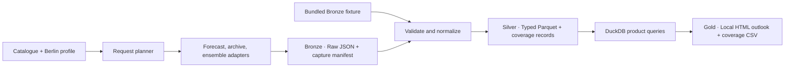

# Loop IQ Open-Meteo pipeline

The current local MVP implements the three temperature requests and the offline replay path. The wider Berlin catalogue below describes the next stage. See [the README](README.md) for the runnable scope, commands, and outputs.

## 1. What problem are we solving?

**When in the next 24 hours should an aged-care facility manager review outdoor activity plans for warmer conditions, and how much do the forecast scenarios vary?**

For Loop IQ’s synthetic Berlin facility, the manager needs the forecast peak, its hour in Berlin time, and the range of outcomes from the ensemble to review the activity schedule. The engineering reviewer needs to see which fields arrived, trace a result to its source, and replay the same capture locally.

### Scope for the Berlin demo

| Product | Endpoint and pinned model | Capture window and sections |
| --- | --- | --- |
| Live forecast | `/v1/forecast`, `dwd_icon_d2_native` | One current snapshot, 24 hours of hourly and 15-minute data, and one complete Berlin-local forecast day for daily values. |
| Historical weather | `/v1/archive`, `era5` | Seven fixed dates with hourly and daily data. Use 21–27 July 2025 for the initial fixture. |
| Ensemble forecast | `/v1/ensemble`, `dwd_icon_d2_eps_native` | The same 24-hour UTC window as the live hourly forecast. Preserve every returned member series. |

Use `52.5200, 13.4050` and `Europe/Berlin` in the site profile. For each selected model and section, ingest all fields supported by the agreed, verified catalogue. The full variable list is an implementation deliverable. Start from the documented fields for each section and verify the model-specific combinations. ERA5 provides historical reanalysis as context. The report should label its dates and source directly. [Forecast API](https://open-meteo.com/en/docs), [DWD ICON API](https://open-meteo.com/en/docs/dwd-api), [Historical Weather API](https://open-meteo.com/en/docs/historical-weather-api), [Ensemble API](https://open-meteo.com/en/docs/ensemble-api), [Open-Meteo model identifiers](https://github.com/open-meteo/open-meteo/blob/main/Sources/App/Controllers/ForecastapiController.swift)

## 2. What does each medallion layer do?



### Bronze · Capture and preserve source data

Bronze captures what Open-Meteo returned and records how the pipeline obtained it. Its output is the original JSON plus a capture manifest. Each request entry records its parameters, response path and checksum, HTTP result, fetch time, and batch status. Live capture and the bundled replay fixture provide the same inputs to Silver.

The catalogue describes source capabilities. The Berlin profile selects a site, product models, sections, and windows. The planner expands that selection into request batches. Each adapter owns the endpoint’s parameters and JSON shape. Shared code handles HTTP, raw storage, validation, row keys, and publication. Adding another model on a supported endpoint should normally require a catalogue entry, a site within its coverage, and a verification run.

**Catalogue contract.** Each model has a product, provider, endpoint, API model ID, coverage region, and expected horizon. Each field belongs to a model and section such as `hourly` or `daily`. Record its request parameter, source field ID, expected unit, value type, and temporal meaning such as instantaneous, preceding-hour sum, or daily maximum. For 15-minute variables, record whether native or interpolated behavior is documented or remains unknown.

**Example catalogue slice.** The full catalogue follows the same structure.

```toml
[[model]]
id = "dwd_icon_d2_native"
product = "forecast"
provider = "DWD"
coverage = "Central Europe"

[[model.variable]]
section = "hourly"
name = "temperature_2m"
unit = "°C"
value_type = "number"
aggregation = "instantaneous"
```

Keep the response evidence distinct from the documented capabilities. For example, a catalogue may list a field whose series is absent or contains only nulls for the Berlin capture. Record that result alongside the exact request and model.

#### Request planning and capture

1. **Plan the windows.** Round the capture start up to the next UTC hour and use explicit hourly request windows for the forecast and ensemble. Normalize both to the same half-open interval `[start, start + 24 hours)`. Anchor the 15-minute window to the same interval. The current section has its own provider validity timestamp. Request daily sections separately in `Europe/Berlin` and store the provider’s calendar date. For forecast daily values, select a full local day available in the model horizon and show its date explicitly. The seven archive dates are fixed and well past ERA5’s publication delay. [Forecast API time parameters](https://open-meteo.com/en/docs), [Ensemble API time parameters](https://open-meteo.com/en/docs/ensemble-api), [ERA5 availability](https://open-meteo.com/en/docs/historical-weather-api)
2. **Fetch and land.** Use one site, model, and section per request with configurable variable batches. Start with 10 fields per time-series batch for predictable request size. Fetch `current` in a single request to keep the validity timestamp consistent across fields. Request UTC Unix time for subdaily data and explicit units where supported. Record original bodies, sanitized parameters, HTTP status, `fetched_at_utc`, returned grid coordinates, checksum, and wall-clock duration. Retain the requested site coordinates separately. Budget by provider-equivalent calls as well as HTTP requests. [Open-Meteo request accounting](https://open-meteo.com/en/pricing)

- **Capture identity.** Start a live capture with a new `capture_id`. Generate a stable `request_id` from that capture ID and the canonical request. Resume a failed capture with its original window and reuse its successful responses. Retry failed batches only while the capture is within the configured collection time budget. Keep each request’s fetch time because the provider can update between batches.
- **Bound retries.** Retry network timeouts, HTTP 429, and transient 5xx responses with capped backoff, jitter, and the provider’s `Retry-After` when present. Report a 400 or invalid request immediately with its product, section, and field batch. Surface failed requests through the run summary and CLI exit status.

### Silver · Validate and standardize

Silver turns Bronze responses into typed, queryable weather data. It preserves UTC validity times, local dates for daily values, units, ensemble member IDs, and the link to the original request. Its outputs are the two weather Parquet tables and a machine-readable coverage table.

1. **Normalize according to the response shape.** `current` is a scalar object with a validity time and an interval. Time-series arrays align to the section’s `time` array. Ensemble member IDs come from the verified response contract. Preserve the original source field name and keep any shared ensemble fields separate from member series. Read units from the matching `*_units` section. Keep a model initialization timestamp when the source provides it. The local `fetched_at_utc` records receipt, and the API’s `generationtime_ms` measures response generation. [Forecast response definitions](https://open-meteo.com/en/docs), [Ensemble API](https://open-meteo.com/en/docs/ensemble-api)
2. **Keep time and value types explicit.** Store subdaily validity timestamps in UTC. Convert to Berlin time with `zoneinfo` for display. Daily rows use `local_date` and include the source timezone. Preserve timestamp-valued variables such as sunrise and sunset with their own type and source offset where needed. Open-Meteo documents fixed-offset daily boundaries across daylight-saving changes. Use demo windows away from a transition and add a test for subdaily DST display. [Open-Meteo timezone behavior](https://open-meteo.com/en/docs)

#### Data model

Use long-format Parquet so a new variable adds rows without changing the core schema. Keep daily aggregates in a separate table with a calendar-date key. Normalize one response batch at a time into DuckDB staging tables, write one file per output table for the current capture, and query only that capture's files when building its report.

| Dataset | Grain and columns |
| --- | --- |
| `weather_samples` | One value per `capture_id`, `product`, `site_id`, `model_id`, `section`, `valid_at_utc`, `variable_id`, and `series_key`. Include `request_id`, original source field name, unit, and interval seconds where supplied. |
| `weather_daily` | Same model and provenance dimensions, with `local_date` and `timezone` as the daily time key. |
| `coverage` | One row per capture, product, model, section, and requested variable. Record field status, expected and returned time slots, returned and non-null value counts, and ensemble member count where relevant. |

`series_key` is a non-null key for uniqueness. Use a fixed key for a single or shared series and a distinct key for each verified ensemble member. Data columns include `value_type`, `value_number`, and `value_timestamp_utc`. Weather codes can use the numeric column with a catalogue type of `code`. Preserve source nulls as SQL `NULL`. Connect every normalized value back to its raw batch through `request_id` and its source field name.

#### Field and batch checks

| Check | Behavior |
| --- | --- |
| Invalid JSON, API error body, malformed timestamps, inconsistent array lengths, or duplicate row keys | Fail the batch and keep the raw response for diagnosis. |
| Requested field absent or returned entirely null | Record `missing` or `all_null` explicitly. Use `unsupported` when verified by provider documentation or a targeted check. Preserve any partially populated series. |
| Undeclared field or unexpected unit | Keep the original response and flag the discrepancy in coverage. Exclude unclassified or unit-mismatched values from analytics until verified. |

### Gold · Produce the facility outlook

Gold turns the validated data into a facility-level outlook and a reviewer-facing coverage summary. It aligns hourly forecast and ensemble values, calculates a percentile band across verified members, and highlights the warmest forecast hour in Berlin time. It also presents the ERA5 context for its seven labelled dates.

Publish the outlook when both forecast products provide usable hourly temperature throughout the target window. Show the actual member count for each hour. If an hour has some ensemble values but lacks an expected member, leave a visible gap in that hour’s P10–P90 band. Fail the outlook quality gate if any hour is missing its deterministic temperature or has zero valid ensemble temperatures.

Missing optional fields or failed optional batches mark coverage as partial. A required-data check failure keeps the build in diagnostics, preserves the last published result, and exits with a nonzero status. Record request duration, response bytes, retries, records written, and coverage results for each capture.

#### Replay and publication

- **Stable replay.** Derive `build_id` from the capture's completed request manifest and payload checksums, the catalogue/profile, and the transformation/report version. Import the fixture’s original capture identity and clock. A replay with the same inputs reuses its published build. A changed input produces a new build, with history still available for audit.
- **Atomic output.** Use one writer per local data directory. Write and verify the Parquet files, coverage, and report in a staging directory. Promote the completed directory with an atomic rename on the same filesystem. Read published directories for serving. An interrupted build leaves raw data available for retry and the last published result readable.

```text
config/
  catalogue.toml
  berlin.toml
fixtures/berlin/                   # Bundled real responses and provenance
data/
  raw/<capture_id>/                # Response bodies and capture manifest
  published/<capture_id>/<build_id>/
    weather_samples.parquet    # Silver
    weather_daily.parquet      # Silver
    coverage.parquet           # Silver
    coverage.csv               # Gold
    outlook.html               # Gold
    manifest.json
```

### Recommended local stack

| Layer | Choice | Reason |
| --- | --- | --- |
| Runtime and packaging | Python 3.12, `uv`, `pyproject.toml`, and a committed `uv.lock` | Gives a reviewer a reproducible local setup. [`uv` lock and sync](https://docs.astral.sh/uv/concepts/projects/sync/) |
| Entry point and configuration | `argparse`, TOML read via `tomllib`, and Python dataclasses | Three commands and a small, versioned catalogue fit in a single package. |
| HTTP ingestion | One `httpx.Client` with explicit timeouts and bounded retries | Shares connections and keeps source failures visible at batch level. |
| Raw storage | Original response bodies plus JSON manifests on local disk | Retains source data, request provenance, and the inputs needed for offline replay. |
| Normalization and analytics | DuckDB with explicit SQL schemas and Parquet written via `COPY` | Provides typed files and SQL analytics in one embedded engine. [DuckDB Parquet documentation](https://duckdb.org/docs/stable/data/parquet/overview) |
| Presentation | Self-contained Plotly HTML and a coverage CSV | The reviewer can open both locally. Embed Plotly.js in the HTML for offline use. [Plotly HTML export](https://plotly.com/python/interactive-html-export/) |
| Verification | `pytest`, small JSON contract fixtures, and one end-to-end replay | Covers source-specific shapes and the complete local flow. |

Run the pipeline on demand from the CLI for the submission. Live capture accesses Open-Meteo over HTTPS. Replay, storage, SQL, and the report run on the reviewer’s machine. The README should carry Open-Meteo attribution and list the source and date range of the bundled fixture. [Open-Meteo usage and attribution](https://open-meteo.com/en/pricing)

### CLI, build order, and acceptance

The commands below define the proposed interface.

```bash
uv sync --locked
uv run --locked weather-pipeline validate-catalogue --profile berlin
uv run --locked weather-pipeline capture --profile berlin
uv run --locked weather-pipeline replay --fixture fixtures/berlin
uv run --locked pytest
```

`capture` runs ingestion through publication using the live API. Support `capture --resume <capture_id>` for a failed capture within its collection window. `replay` runs normalization through publication from saved responses and prints the generated report path. Give fixture and live runs separate default output roots so the demo report always opens from its intended source.

1. **Prove the three requests.** Fetch one temperature field per endpoint, then exercise `current`, `minutely_15`, and `daily` separately. Check the exact native model IDs, supported section fields, UTC boundaries, daily date shape, and ensemble member encoding. Save the successful bodies and request parameters.
2. **Build the narrow vertical path.** Land and replay those same payloads, produce typed Parquet, and build the first forecast-and-ensemble chart. Reuse that path as field coverage grows.
3. **Complete the catalogue.** Batch and verify the supported fields, capture the broad Berlin fixture, and add coverage output. Measure elapsed time and data size for the live capture and offline replay.
4. **Verify the demo.** After initial installation, replay works with network access disabled. The frozen fixture yields 24 expected hourly timestamps for each forecast product and 96 expected 15-minute timestamps for the live forecast. Daily output yields one forecast date and seven archive dates. The second replay keeps the same `build_id` and row counts, and a malformed batch leaves the last published report readable. Check missing and null fields, date handling, and ensemble identity with focused fixtures.

The three temperature requests, their windows, and the ICON-D2-EPS member encoding were verified in a live capture. Its saved responses are bundled for replay. The wider model and field combinations still need the smoke tests in step 1.

## 3. What does the pipeline output tell us?

The primary output is an offline HTML **24-hour facility weather outlook**. Put the warmest forecast hour at the top with the deterministic temperature and the ensemble range at that hour, then show how conditions change before and after it. If the ensemble range at the peak hour is unavailable, show the available member count and expected count.

An illustrative result would read **Warmest forecast hour 15:00 Berlin time · Forecast 31 °C · Ensemble P10–P90 28–33 °C**. The manager can review activities planned for that period and use the hourly chart to compare earlier or later times. The ensemble band shows how the member temperatures vary. The historical panel gives context from the selected ERA5 dates.

### What the reviewer sees

- **Next 24 hours.** Plot deterministic hourly `temperature_2m` alongside the P10–P90 range of hourly ensemble `temperature_2m` values. Align on the site, capture, and UTC valid hour. Compute percentiles over verified member values with DuckDB `quantile_cont`. Show the ensemble member count, Berlin-local hour, capture timestamp, and model names. [DuckDB aggregate functions](https://duckdb.org/docs/stable/sql/functions/aggregates.html)
- **Historical context.** Put the seven ERA5 dates in a second panel with daily minimum and maximum temperature. Label it **Historical reanalysis** and display the date range.
- **Coverage and lineage.** Show a small summary table by product and section, including requested, returned, and populated fields. Provide the full coverage CSV. For a selected plotted value, surface the capture ID, source batch, validity time, and raw field name.

### 15-minute presentation

| Presentation time | Demonstration |
| --- | --- |
| 0–3 min | Open the outlook and explain the operational decision. |
| 3–7 min | Run the offline replay and compare coverage across the three products. |
| 7–11 min | Trace one forecast value to JSON and show how the ensemble range is computed. |
| 11–15 min | Replay again, show the stable build and row counts, and explain how another model is added through configuration. |
