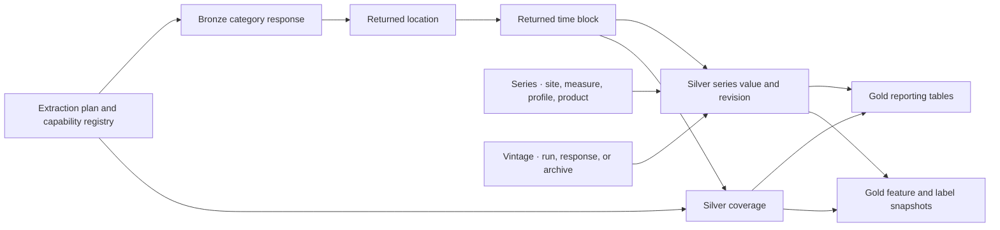

# Open-Meteo warehouse design

Python plans extraction and parses responses. SQL in `weather.duckdb` stores the raw evidence, normalizes measurements, and publishes reporting and ML tables. Scope is every verified output of the free, non-commercial public API within the configured geography, history, and request profiles. The footprint, history and retention windows, geocoding inputs, and parameter profiles determine the extraction workload. This document carries forward the agreed Bronze design and Silver v1, and proposes Gold v1.



## Bronze

### Category tables

| DuckDB response table | API products |
| --- | --- |
| `bronze.weather_forecast` | Live Forecast, Historical Forecast, Single Runs, Previous Runs, and provider-specific forecast variants |
| `bronze.historical_weather` | Historical Weather reanalysis, including ERA5 and ERA5-Land |
| `bronze.ensemble_models` | Ensemble members and provider-supplied summaries |
| `bronze.seasonal_forecast` | Seasonal and subseasonal forecasts |
| `bronze.climate_change` | Climate model projections |
| `bronze.marine_forecast` | Marine forecasts |
| `bronze.air_quality` | Air quality and pollen |
| `bronze.satellite_radiation` | Satellite-derived radiation |
| `bronze.flood` | Forecast and historical river discharge |
| `bronze.geocoding` | Place searches and lookups |
| `bronze.elevation` | Elevation lookups |

`api_product` identifies the actual product inside a category. Historical Forecast archives predictions and shares the forecast category. Historical Weather supplies a separate comparison series. [Open-Meteo product catalog](https://open-meteo.com/en/features), [Historical Forecast API](https://open-meteo.com/en/docs/historical-forecast-api), [Historical Weather API](https://open-meteo.com/en/docs/historical-weather-api)

### Response, point, and block grains

Each category response table uses the same envelope. One row represents **one HTTP attempt**. A forecast attempt uses one requested model or blend and can cover multiple locations, fields, or time blocks. Each new attempt gets its own `fetch_id`.

| DuckDB types | Response columns |
| --- | --- |
| `UUID`, `INTEGER` | `fetch_id` (PK), `slice_id` (FK), `attempt_no`. Unique `(slice_id, attempt_no)` per category. |
| `VARCHAR` | `api_product`, `source_host`, `source_path`, `provider_code`, `requested_model_selector`, `selector_kind`, `content_type`, `fetch_error`, `body_sha256` |
| `JSON` | `request_params`, including ordered coordinates, time controls, requested fields, timezone, units, cell selection, elevation, and solar options. Omit credentials. |
| `TIMESTAMPTZ` | `requested_run_at`, `requested_at`, `fetched_at` |
| `INTEGER`, `BLOB`, `DECIMAL(12,3)` | `http_status`, `response_body`, `estimated_call_units` |

Each time-series category has a `_point` and a `_block` table. The block points to data and units in the stored body. Two locations with four blocks each yield one attempt, two points, and eight blocks.

| Table and key | Columns |
| --- | --- |
| `bronze.weather_forecast_point` · `(fetch_id, result_index)` | `fetch_id UUID`. `result_index`, `request_index`, `utc_offset_seconds` as `INTEGER`. `location_key`, `requested_location_name`, `requested_timezone`, `returned_timezone`, `timezone_abbreviation`, `result_json_path` as `VARCHAR`. `requested_latitude`, `requested_longitude`, `returned_latitude`, `returned_longitude`, `returned_elevation_m`, `generationtime_ms` as `DOUBLE`. |
| `bronze.weather_forecast_block` · `(fetch_id, result_index, block_code)` | `fetch_id UUID`. `result_index`, `sample_count`, `current_interval_seconds` as `INTEGER`. `block_code`, `data_json_path`, `units_json_path`, `first_time_raw`, `last_time_raw` as `VARCHAR`. `returned_fields VARCHAR[]`. |
| `bronze.geocoding_result` · `(fetch_id, result_index)` | One returned place. `fetch_id UUID`, `result_index INTEGER`, `place_id BIGINT`. `latitude`, `longitude` as `DOUBLE`. `place_name`, `requested_language`, `country_code`, `timezone`, `result_json_path` as `VARCHAR`. |
| `bronze.elevation_result` · `(fetch_id, request_index)` | One returned elevation per requested coordinate. `fetch_id UUID`, `request_index INTEGER`, `result_json_path VARCHAR`. `requested_latitude`, `requested_longitude`, `elevation_m` as `DOUBLE`. |

Every child key references its parent. Keep failed attempts, raw timestamps, and original field keys, including member suffixes and level or solar variants. An inspection view can expose a block by joining the child tables to the response and reading the recorded JSON paths.

### Planning and completeness

| Table | Grain and principal columns |
| --- | --- |
| `ops.forecast_model` | One version of a model dataset. `model_version_id`, `provider_code`, `model_code`, `domain_code`, `grid_version`, `spatial_resolution`, `resolution_unit`, `nominal_horizon_hours`, `nominal_update_interval_seconds`, `metadata_url`, `effective_from`, `effective_to`. |
| `ops.api_capability` | One versioned rule per product, selector, domain, block, and field. `capability_id`, `api_product`, `requested_model_selector`, `domain_code`, `block_code`, `api_field`, `request_limits`, `data_horizon_hours`, `native_step_seconds`, `support_status`, `verified_at`, `effective_from`, `effective_to`. |
| `ops.extraction_slice` | One planned batch. `slice_id`, `slice_key`, `category`, `api_product`, `requested_model_selector`, `spatial_batch_key`, `profile_key`, `bundle_key`, `window_start`, `window_end`, `poll_slot_at`, `requested_run_at`, `trigger_poll_id`, `not_before_at`, `expected_fields`, `estimated_call_units`, `status`, `coverage_result`. |
| `bronze.model_update` | One metadata poll attempt. `poll_id`, `model_version_id`, `metadata_url`, `checked_at`, `http_status`, `response_body`, `body_sha256`, `fetch_error`. |

- Plan by product, selector, spatial batch, profile, field bundle, and window or run. Pin the applicable capability versions when planning. Retry the stable slice. Validate coverage against the requested location, block, fields, and verified horizon, even after an HTTP 200.
- Prioritize live captures and use the remaining call budget for backfills. Open-Meteo lists free-tier budgets of 600 calls per minute, 5,000 per hour, 10,000 per day, and 300,000 per month. A request can use fractional or multiple call units. Record `deferred_quota` for queued work. [Open-Meteo plan limits and call accounting](https://open-meteo.com/en/pricing)
- Poll the non-commercial Model Updates feed and use the recommended ten-minute propagation buffer. Retain the poll that triggered the slice. Exact-run identity comes from verified run evidence, such as the Single Runs `run=` selector. Metadata polls are exempt from the daily and monthly limits. [Model Updates](https://open-meteo.com/en/docs/model-updates), [Single Runs](https://open-meteo.com/en/docs/single-runs-api)

## Silver

### Shared series model

One native DuckDB fact table serves the time-series products. `silver.series` identifies a recurring signal. `silver.vintage` identifies a run, response capture, or archive stream. `silver.series_value` records the value and revision.

| Table | Grain and principal columns |
| --- | --- |
| `silver.product` | One API product. `product_id` (PK), `bronze_category`, `api_product`, `data_kind`. |
| `silver.site` | One requested location. `site_id` (PK), `location_key`, `latitude`, `longitude`, `display_name`, optional `place_id`. |
| `silver.source_point` | One reported source point. `source_point_id` (PK), `latitude`, `longitude`, `elevation_m`, optional `grid_version`. |
| `silver.measure` | One versioned measurement definition. `measure_id` (PK), `quantity_code`, `vertical_kind`, `level_from`, `level_to`, `level_unit`, `temporal_statistic`, `canonical_unit`, `value_type`, `definition_version`. |
| `silver.field_mapping` | One versioned API field mapping. `mapping_id` (PK), `product_id`, `selector_scope`, `block_code`, `api_field`, `measure_id`, `time_window_rule`, `mapping_version`. |
| `silver.request_profile` | One set of value-affecting request options. `profile_id` (PK), `cell_selection`, `elevation_mode`, `elevation_override_m`, `aggregation_timezone`, `solar_tilt`, `solar_azimuth`, `options_json`. |
| `silver.series` | One recurring signal. `series_id` (PK), `product_id`, `site_id`, `measure_id`, `profile_id`, `requested_model_selector`, `block_code`, `output_cadence`, `member_kind`, `member_number`, `ensemble_statistic`, `ensemble_percentile`, `scenario_code`, `fixed_lead_hours`. |
| `silver.vintage` | One versioning scope per product. `vintage_id` (PK), `product_id`, `vintage_kind`, `source_key`, `initialized_at`, `captured_at`. A vintage can cover many series. |
| `silver.place`, `silver.place_name`, `silver.geocode_match` | Provider place ID, localized names, and ranked matches per fetch. |
| `silver.elevation`, `silver.model_update_observation` | Versioned site elevation by source, and typed update metadata per successful poll. Retain `fetch_id` or `poll_id` for lineage. |

Enforce one `series_id` per logical identity, with a null-safe comparison for optional dimensions. Use `member_kind` to distinguish a deterministic value, a member, a shared field, or a statistic. A 2 m temperature series and an 850 hPa temperature series use different measures. Separate daily and hourly temporal definitions, interpolation provenance, and source windows are available to consumers.

**`silver.series_value` key** · `(series_id, vintage_id, valid_at, revision_no)`.

| DuckDB types | Fact columns |
| --- | --- |
| `BIGINT` | `series_id`, `vintage_id`, `source_point_id`, `source_model_version_id`, `mapping_id`. The source point and attributable model are nullable. |
| `TIMESTAMPTZ` | `valid_at`, `window_start`, `window_end`, `source_available_at`, `warehouse_available_at`. Preserve source intervals and the instant represented by the API. |
| `DATE`, `VARCHAR`, `INTEGER` | `source_date`, `source_timezone`, `source_utc_offset_seconds`. |
| `DOUBLE`, `INTEGER`, `TIMESTAMPTZ`, `BOOLEAN`, `VARCHAR` | One populated typed value column as defined by the measure. `value_number`, `value_code`, `value_timestamp`, `value_boolean`, `value_text`. Source-null rows have all five unset. |
| `VARCHAR` | `source_unit`, `quality_status`, `sampling_origin` such as native, interpolated, or unknown. |
| `INTEGER`, `UUID`, `VARCHAR` | `revision_no` and original source coordinates `fetch_id`, `result_index`, `block_code`, `api_field`, `sample_index`. Product identifies the Bronze category. |

An **exact run** groups batches by verified model and initialization. A **live capture** defaults to one vintage per successful response. A **stable archive** groups by product and dataset, and keeps revisions. A **Previous Runs** series carries its published fixed lead on `silver.series`. Compute exact-run lead from `valid_at - initialized_at`. Leave unknown timestamps and source-model attribution null. `source_available_at` is verified availability for the specific value or revision. `warehouse_available_at` is when the warehouse first exposed that version to readers. An archive downloaded today can contain a run initialized months earlier. [Single Runs](https://open-meteo.com/en/docs/single-runs-api), [Previous Runs](https://open-meteo.com/en/docs/previous-runs-api)

### Missing data, inconsistencies, and duplicates

`silver.coverage` stores the detailed coverage behind `ops.extraction_slice.coverage_result`. Its grain is slice × requested location × block × field × affected interval. Record expected, returned, usable, explicit-null, invalid, and missing slots, plus expected and usable members where verified. Coverage tracks planned work even when there is no response or normalized row. The fact's `quality_status` describes a returned value.

| Bronze input | Silver result |
| --- | --- |
| Hourly precipitation is `[0.0, null]`. | Store a valid zero and a separate `source_null` row. |
| An expected 850 hPa field or entire location is missing, a regional horizon ends, or the slice is waiting for quota. | Record `missing_field` or `missing_location`, `outside_horizon`, or `deferred_quota` respectively. Verified unsupported combinations get `unsupported`. An omitted field outside a slice's bundle is expected in its own slice. |
| Two timestamps arrive with one wind speed. | Quarantine that field with `array_length_mismatch`. Load well-formed sibling fields. Failure of the shared time or location axis quarantines the affected block or location. |
| Temperature arrives as 68 °F, while another request returns 20 °C. | Convert from the returned unit, preserve `source_unit`, and quarantine an unknown or incompatible unit. |
| One `12:00` timestamp is UTC and another has offset +01:00. | Store 12:00 UTC and 11:00 UTC, respectively. Preserve source offsets and calendar windows for period values. |
| Requested and returned coordinates differ, or two radiation fields share units but have different windows. | Join on the requested `site_id` and keep the reported grid point separately. Use the mapped statistic, cadence, and averaging window for radiation. [Forecast variable definitions](https://open-meteo.com/en/docs) |
| An exact-run retry or overlapping archive slice returns the same normalized observation. | Keep one fact version and link each raw occurrence through `silver.series_value_source`. |
| An archive value of 12.0 °C later has a verified correction to 12.4 °C. | Append a revision with its own availability. Quarantine unordered conflicts until resolved. |
| The 00:00 and 06:00 runs both predict 12:00, or a forecast and reanalysis share a valid time. | Preserve the distinct vintages and product identities. |

`silver.series_value_source` links the fact key to each Bronze occurrence. Its ingestion key is `(fetch_id, result_index, block_code, api_field, sample_index, mapping_id)`. A replay with the same mapping is idempotent. A mapping correction that changes an existing value creates a new warehouse revision. A change in meaning receives a new measure definition. Parse in Python, stage and validate batches, then commit facts, provenance, and coverage together. Keep raw responses available for replay.

### Quality gate from Bronze to Silver

Run this gate for every slice processed into Silver, including replays. Derive expectations from the slice's request and pinned capability rules. Python checks the raw response and preserves array positions. DuckDB SQL checks the staged rows and compares expected keys with returned keys before insertion. Checks run at the smallest scope whose data can be interpreted independently.

| When | Check | Outcome |
| --- | --- | --- |
| Before parsing a response | Verify the body checksum. Check that the attempt succeeded and the body parses as the expected response type. | An unusable response contributes no facts. Retain the attempt and record the slice outcome for retry or replay. |
| Before expanding a result or block | Match the returned object to a requested location. Parse timestamps, check the shared time axis for duplicate slots, and compare actual slot keys with the requested window and cadence. | Quarantine a result with ambiguous location identity or a block with an unusable shared time axis. Record missing slots against the plan. Two returned hours can still leave a gap if one is outside the requested window. |
| Before pairing a field to its time axis | Compare array lengths, resolve the field mapping and returned unit, and verify types. For scalar `current` fields, apply the scalar contract. For ensemble fields, verify member identity where the contract defines it. | Quarantine a field whose values cannot be tied to time, measure, or member. Quarantine individual invalid values when their positions are known. Accept explicit source nulls with `quality_status = 'source_null'`. Preserve valid siblings. |
| After unit normalization | Apply measure-specific validity rules. For example, an hourly precipitation accumulation must be nonnegative. | Quarantine a value outside its defined domain. Flag an unusual but plausible value for review and keep it available with a quality flag. |
| Before committing normalized rows | Check the fact key, dimension and source links, timestamp and interval semantics, and typed value column. Compare each candidate with the accepted value at the same series, vintage, and valid time. | Collapse identical retries. Append verified corrections as revisions. Record unresolved conflicts with raw lineage. Roll back the load if the remaining rows violate a database invariant. |
| For reference products | Check place IDs and coordinate types, and match elevations to requested coordinate indexes. Apply each endpoint's result-count contract. | Record a valid empty geocoding result, a missing elevation, and an invalid response as distinct outcomes. |

For instance, the parser can stage one row per returned array with its length and the time-axis length. This query returns fields to quarantine before their arrays are expanded. Explicit nulls count toward `value_count`.

```sql
SELECT fetch_id,
       result_index,
       block_code,
       api_field,
       time_count AS expected_array_length,
       value_count AS returned_array_length,
       'array_length_mismatch' AS issue_code
FROM staged_field_shape
WHERE value_count <> time_count
```

For a two-hour block with precipitation `[0.0, null]` and wind speed `[4.0]`, Silver accepts the two precipitation positions as one usable zero and one explicit null. The query flags wind speed and Silver quarantines that field. Coverage for wind records two expected slots and zero usable slots. Its lone value remains traceable to the Bronze body.

Write detailed failures to `ops.quality_issue` with `slice_id`, `fetch_id` when available, location, block, field, affected time range, rule code, and disposition. Use a stable issue key for idempotent replays. Keep detailed diagnostics even if a load rolls back. Use `silver.coverage` for planned versus usable data by slice. Gold can query both through DuckDB for operational reporting.

## Gold v1

### Physical tables and join keys

Gold exposes the following physical tables in DuckDB. Each contract version pins its input products, selectors, profiles, measures, required fields, quality thresholds, and time semantics. Sites and measures reuse Silver keys. In the table below, source scope means `(site_id, product_id, requested_model_selector, profile_id)`. Use a stable non-null selector code for products without a selector.

| Table | Primary key and grain | Principal columns |
| --- | --- | --- |
| `gold.forecast_release` | `release_id` · one immutable, vetted forecast selection for a contract, scope, and target window | `contract_version`, source scope, `window_start`, `window_end`, `vintage_id`, `initialized_at`, `required_inputs_available_at`, `published_at`, `coverage_status`, `build_id` |
| `gold.forecast_hourly_latest` | `(contract_version, source scope, valid_at)` · one current forecast hour per scope | `release_id` (FK), `temp_2m_c`, `precip_mm`, `wind_10m_ms`, `coverage_status` |
| `gold.weather_daily` | `(contract_version, source scope, reporting_timezone, local_date)` · one reporting day per reference dataset and profile | `window_start`, `window_end`, `temp_min_c`, `temp_max_c`, `precip_mm`, `wind_gust_max_ms`, `metric_coverage`, `build_id` |
| `gold.environment_daily` | `(contract_version, source scope, reporting_timezone, local_date, metric_code)` · one environmental metric per reporting day and source | `window_start`, `window_end`, `value_number`, `unit`, `expected_slots`, `usable_slots`, `coverage_status`, `build_id` |
| `gold.ensemble_hourly` | `(release_id, measure_id, valid_at)` · one member-derived distribution per forecast hour | `p10`, `p50`, `p90`, `expected_members`, `usable_members`, `coverage_status` |
| `gold.ml_dataset` | `dataset_id` · one immutable training dataset build | `feature_set_version`, `label_set_version`, `availability_basis`, `feature_surface`, `build_cutoff_at`, `build_id` |
| `gold.ml_forecast_features` | `(dataset_id, source scope, decision_at, valid_at)` · one feature vector per decision and target hour | `vintage_id`, optional `release_id` for served forecasts, `initialized_at`, `feature_available_at`, `lead_hours`, `horizon_hours`, `forecast_temp_c`, `forecast_precip_mm`, `missing_required_features` |
| `gold.ml_weather_labels` | `(dataset_id, site_id, valid_at)` · one reference target per site and hour under the dataset's fixed label contract | `target_temp_c`, `reference_product_id`, `reference_profile_id`, `label_available_at`, the Silver fact key, `label_status` |

`gold.series_values` is a SQL view joining the full Silver catalog to readable site, product, measure, profile, and vintage attributes. It exposes all revisions and both availability clocks, including pressure levels, seasonal periods, climate scenarios, and individual ensemble members. A new source field becomes discoverable after Silver validation. Adding it to a curated table is a contract change.

### Reporting rules

Before publication, validate the consumer contract in DuckDB SQL. Check required slots and measures, release coherence, reporting windows, and ML availability cutoffs. A Gold contract that requires wind across the full horizon rejects the example release above. A temperature report can publish if its own inputs pass. Silver records what can be trusted from the API. Gold decides whether that data is sufficient for a specific table or dataset.

1. **Choose a release before pivoting measures into columns.** For each forecast scope, select the newest eligible exact run that covers the contract's required window. Rank by initialization time, with a deterministic tie-break for revisions. For a live contract, rank by capture time and use a single response unless provider evidence establishes a common run across responses. A poll tie by itself gives no such evidence. Keep `initialized_at` nullable. Record the exact selected revisions for the release. Replace the entire affected forecast scope in one transaction so every hour resolves to the same release. If a new candidate fails, retain the previous release and show its issue time, window, and freshness.
2. **Aggregate daily values on their actual intervals.** Derive reporting day boundaries from the reporting timezone and keep them in UTC. A local day can have 23 or 25 hours. Use a provider daily value if its interval and statistic match the contract. Otherwise aggregate one pinned source of aligned higher-frequency measurements. For example, sum precipitation only with complete coverage of the day by non-overlapping accumulation windows. Count expected slots once from the target calendar, including when extraction slices overlap. Keep metric-level coverage and publish SQL `NULL` when the contract's threshold fails.
3. **Calculate ensemble statistics on distinct verified members in the same release.** Use `quantile_cont(value_number, [0.10, 0.50, 0.90])` and store the expected and usable member counts per measure and hour. In v1, publish the percentiles only for a complete verified roster. If the expected roster is unknown, keep the usable count and flag the range as unavailable. Provider-reported percentiles have their own Silver series and can be exposed as a separately sourced report. [DuckDB aggregate functions](https://duckdb.org/docs/1.4/sql/functions/aggregates.html)

### Point-in-time ML and forecast verification

- **Operational features.** Use `warehouse_available_at <= decision_at` for each input version. Pin the serving surface in `gold.ml_dataset`. For a Silver-backed model, choose an eligible coherent run or capture and the latest eligible revision of each input within it. For a Gold-backed model, use the release that was current at `decision_at` and the exact revisions that release exposed. Keep publication history for that lookup. The availability stored on the feature row is the latest availability of its contributing inputs and applicable release. Apply the same cutoff to rolling inputs and keep missing predictors null with indicators.
- **Historical reconstruction.** Use a separate dataset with `availability_basis = 'verified_source'`. Require evidence that each input revision was available at the simulated decision time. A run initialization timestamp supplies lead time. A late archive download supplies warehouse availability. Neither timestamp establishes original availability. Exact-run `lead_hours` measures target minus initialization. `horizon_hours` measures target minus decision.
- **Labels.** Select the target from the label contract's reference data, for example ERA5 2 m temperature for forecast verification. Align site, measure semantics, and target interval. For v1, a dataset pins one hourly target definition and reference selection rule. Pick the eligible label revision at the frozen dataset's build cutoff. Keep its availability and provenance even when the reference arrives after the prediction. Apply later corrections in a new dataset build so earlier training exports are reproducible.

For example, a run initialized at 06:00 UTC with required features available in the warehouse at 06:12 and a Gold release published at 06:14 is ineligible at 06:10. At 06:13 it is eligible for a model reading Silver, and at 06:14 it is eligible for a model reading the published release. A 12:00 target has six hours of run lead in each eligible case. A reference value published the following day can label that target once included by the dataset's build cutoff.

```sql
SELECT f.site_id,
       f.decision_at,
       f.valid_at,
       f.lead_hours,
       f.forecast_temp_c,
       l.target_temp_c
FROM gold.ml_forecast_features AS f
JOIN gold.ml_weather_labels AS l
  ON l.dataset_id = f.dataset_id
 AND l.site_id = f.site_id
 AND l.valid_at = f.valid_at
JOIN gold.ml_dataset AS d
  ON d.dataset_id = f.dataset_id
WHERE f.dataset_id = 'temperature_training_v1'
  AND d.availability_basis = 'warehouse'
  AND f.feature_available_at <= f.decision_at
  AND l.label_available_at <= d.build_cutoff_at
  AND NOT f.missing_required_features
  AND f.forecast_temp_c IS NOT NULL
  AND l.target_temp_c IS NOT NULL
```

### Refresh, lineage, and growth

- **Version the work.** `ops.gold_contract` keys the table contract by `(contract_name, contract_version)` and records the SQL and selection rules. `ops.gold_build` keys each build by `build_id` and records the input watermark, code and configuration versions, affected scopes, row counts, quality results, and publication time. A release or published output traces to its build. Retain exact Silver fact keys for selected inputs and an immutable input manifest or reproducible selection against the pinned watermark for aggregates.
- **Recompute affected keys.** A new run refreshes the affected forecast scope. If a source interval changes, refresh the reporting days intersected by either interval. New ML dataset builds use corrections according to their decision and label cutoffs. Existing dataset IDs continue to identify their frozen rows. Stage in SQL, validate key uniqueness, coverage, and eligibility, then swap the affected serving rows and update the build watermark in one transaction. Replaying the same inputs and contract is idempotent. [DuckDB transactions](https://duckdb.org/docs/1.4/sql/statements/transactions.html)
- **Evolve from the catalog.** Verify new capabilities, add mappings, and schedule affected slices. Apply compatible unit conversions in Silver. Version semantic changes and replay affected Bronze responses. Version Gold contracts when an output column, aggregation, or feature rule changes.
- **Measure the serving workload.** Use one DuckDB writer process and parallelize rate-limited HTTP fetches. Serve concurrent SQL within that process, or provide a versioned read-only snapshot for independent processes. Keep repeatedly queried Gold tables physical. As Silver history grows, benchmark cold Parquet organized by product and valid-time range before moving historical partitions behind the same SQL interface. Measure source-to-Gold freshness, live and backfill throughput, and p95 latency for a date-filtered report, a multi-year aggregation, and a training export. [DuckDB concurrency](https://duckdb.org/docs/1.4/connect/concurrency.html), [DuckDB file formats](https://duckdb.org/docs/1.4/guides/performance/file_formats.html)

For sizing, 100 sites × 4 runs per day × 48 target hours × 20 fields × 20 members would add 7.68 million Silver values per day before revisions. Full-history scans and training exports grow with the data they read. The latest hourly table stays bounded by the published scopes and forecast horizons.

### Design checks

| Scenario | Expected outcome |
| --- | --- |
| A repeated archive slice returns the same data. | Silver fact count and completed Gold build identity stay stable. Bronze retains each attempt. |
| An hourly field is absent in one batch, or returns a valid zero. | The missing field has coverage evidence. The zero contributes to complete aggregates. |
| Multiple live bundles share a metadata poll but have unverified run alignment. | A multi-field release requiring those bundles remains ineligible. |
| A daily precipitation window spans a daylight-saving transition. | The total uses the true reporting-day boundaries and eligible accumulation intervals. |
| An ensemble member is missing. | Counts expose the gap and derived percentiles are null for that hour. |
| A run and one of its revisions become available after an ML decision. | Neither version enters that decision's features. An earlier eligible release can still supply them. |
| An input or label revision arrives after a training dataset is frozen. | A later dataset can use it. The original dataset reproduces its previous result. |

The open Gold decisions are the first published measure sets, forecast horizons, reporting calendars, and ML target definitions. These belong in versioned contracts. The extraction inventory sets the broader warehouse scope.
